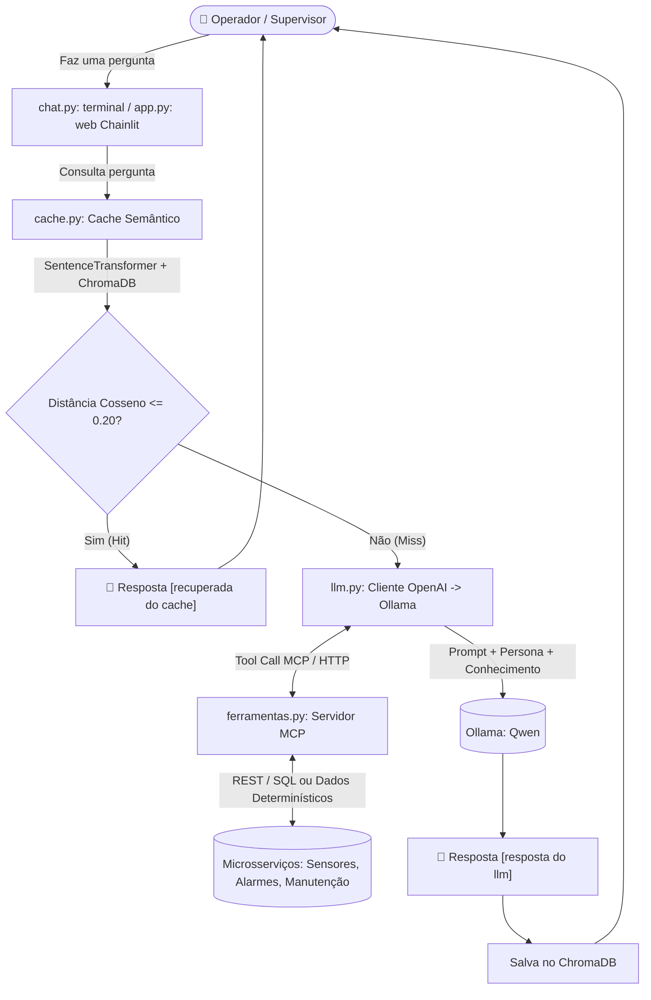

# 🏭 PlantaBot — Sistema Especialista para Supervisão e Manutenção de Planta Industrial

🎓 **Atividade Acadêmica**  
Projeto desenvolvido para a disciplina **Sistemas Especialistas para Web**  
**Curso:** Pós-Graduação em Desenvolvimento para Web  
**Instituição:** Instituto Federal de Educação, Ciência e Tecnologia da Bahia ([IFBA](https://portal.ifba.edu.br/))  
**Professor:** Luis Paulo da Silva Carvalho  

---

## 📌 Visão Geral

O **PlantaBot** é um agente inteligente e sistema especialista conversacional voltado ao diagnóstico operacional, supervisão de sensores, análise de alarmes de limite excedido (*setpoints*) e gestão de manutenção (preventiva, preditiva e corretiva) de uma planta industrial de pequeno porte (**PlantaView**).

O sistema integra Modelos de Linguagem de Larga Escala (LLMs) executados localmente através do **Ollama** e, na avaliação, o **Gemini** do Google como julgador, combinando:
- **Engenharia de Prompt, Persona Especialista e Base de Conhecimento Estruturada (`conhecimento/planta.json`)**;
- **Restrição de Escopo (*Guardrails*)**;
- **Ferramentas MCP (*Model Context Protocol*)** para consulta de telemetria, alarmes e ordens de serviço em tempo real em um servidor MCP único (`ferramentas.py`);
- **Cache Semântico Vetorial (`cache.py`)** com embeddings (`SentenceTransformer`) e `ChromaDB`;
- **Avaliação Automatizada com LLM-as-a-Judge (`julgamento.py`)** e testes unitários (`teste.py`);
- **Interface web com Chainlit (`app.py`)**, além do chat de terminal (`chat.py`).

---

## 🚀 Principais Funcionalidades

- **Persona Especialista (`PlantaBot`):** Atua estritamente como especialista em instrumentação, supervisão e manutenção industrial dos 8 equipamentos da planta (*Bombas 1 e 2, Compressores 1 a 3, Motores 1 e 2, e Caldeira 1*).
- **Restrição de Domínio (*Guardrails*):** Caso receba perguntas fora do escopo industrial, o assistente recusa educadamente o atendimento (`"não posso responder esta pergunta"`).
- **Cache Semântico com Embeddings (`cache.py`):** Antes de acionar o LLM/MCP, o sistema gera embeddings da pergunta com `paraphrase-multilingual-MiniLM-L12-v2` e consulta uma coleção vetorial no `ChromaDB` (distância de cosseno $\le 0.20$). Perguntas semanticamente equivalentes são respondidas com a indicação `[recuperada do cache]`. Respostas obtidas com ferramentas MCP (estado da planta naquele instante) e recusas de escopo não são gravadas no cache.
- **Ferramentas MCP (`ferramentas.py`):** Exposição de ferramentas via *Model Context Protocol* (`streamable-http`) para consulta de leituras de sensores, alarmes por severidade e ordens de serviço, integrando-se aos microsserviços REST/PostgreSQL (`servicos/`). Se eles estiverem desligados, as ferramentas devolvem dados simulados de contingência, identificados no campo `fonte`, e o chat avisa o operador.
- **Validação com LLM-as-a-Judge (`julgamento.py`):** O Gemini do Google (`gemini-3.5-flash-lite`, via biblioteca `google-genai`) atua como julgador e avalia automaticamente se as respostas do assistente local (`qwen3:4b`) atendem aos critérios técnicos (`ATENDE`) e rejeita alucinações deliberadas (`NÃO ATENDE`).
- **Interface Web com Chainlit (`app.py`):** alternativa ao chat de terminal, com a mesma persona, base de conhecimento, cache e ferramentas. A resposta aparece em *streaming*; cada ferramenta MCP executada vira uma etapa que pode ser aberta (argumentos enviados e dados devolvidos); o raciocínio do modelo fica num bloco recolhido; consultas de leituras de sensores trazem um gráfico (`graficos.py`) com a faixa de operação (setpoints) e o valor lido de cada grandeza; o rodapé de cada resposta indica a origem (cache ou LLM) e quantas ferramentas foram consultadas; dados de contingência, servidor MCP fora do ar e Ollama indisponível geram avisos destacados; perguntas iniciais sugerem o que o PlantaBot sabe fazer.
- **Memória da conversa:** as últimas 8 mensagens da sessão acompanham cada nova pergunta (`LIMITE_HISTORICO` em `chat.py`).
- **Testes Automatizados (`teste.py`):** Suíte `unittest` para validação de assertividade conceitual e filtros de escopo.

---

## 🏗️ Arquitetura do Sistema



---

## 📂 Estrutura de Arquivos

```text
supervisorio-especialista/
│
├── conhecimento/
│   ├── planta.json           # Base de conhecimento estruturada da planta industrial (20 itens)
│   └── planta_menor.json     # Subconjunto enxuto para avaliação rápida no LLM-as-a-Judge
│
├── cache/                    # Diretório de persistência do banco vetorial ChromaDB
│
├── servicos/                 # (Opcional) Microsserviços REST Flask + PostgreSQL + Dashboard Web (dashboard.html)
│
├── cache.py                  # Gerenciamento de cache semântico (SentenceTransformer + ChromaDB)
├── ferramentas.py            # Servidor MCP unificado de ferramentas da planta (porta 8000)
├── llm.py                    # Comunicação com o servidor local do Ollama via API OpenAI
├── chat.py                   # Interface interativa de terminal e ciclo principal do especialista PlantaBot
├── app.py                    # Interface web do PlantaBot com Chainlit (streaming, etapas de ferramenta, gráficos)
├── graficos.py               # Gráficos Plotly das leituras de sensores exibidos na interface web
├── chainlit.md               # Página de boas-vindas da interface web
├── .chainlit/                # Configuração do Chainlit (nome, idioma pt-BR, traduções)
├── julgamento.py             # Pipeline de avaliação com LLM-as-a-Judge e detecção de alucinações
├── teste.py                  # Testes de unidade automatizados (unittest)
├── requirements.txt          # Dependências Python do projeto
├── requirements-web.txt      # Dependências da interface web (Chainlit e Plotly)
├── .env.example              # Modelo do .env com a chave da API do Gemini (GOOGLE_API_KEY)
├── SDD-PlantaIndustrial.md   # Documento de especificação de projeto (Software Design Description)
├── roteiro-video.md          # Roteiro do vídeo de apresentação (até 8 minutos)
└── README.md                 # Documentação do projeto
```

---

## 🛠️ Tecnologias Utilizadas

- **Linguagem:** Python 3.10+
- **Servidor de LLM Local:** [Ollama](https://ollama.com/)
  - **Modelo Assistente:** `qwen3:4b`
- **LLM Julgador:** [Google Gemini](https://ai.google.dev/) (`gemini-3.5-flash-lite`), acessado pela API do Google com a chave `GOOGLE_API_KEY`
- **Embeddings & Vetorização:** `sentence-transformers` (`paraphrase-multilingual-MiniLM-L12-v2`)
- **Banco Vetorial:** `chromadb` (persistência local com distância de cosseno)
- **Servidor e Cliente MCP:** `fastmcp` / `mcp` (`streamable-http`)
- **Clientes LLM:**
  - `openai` para o assistente, consumindo o endpoint compatível do Ollama em `http://localhost:11434/v1/`
  - `google-genai` para o julgador, no formato de requisição nativo do Gemini (`models.generate_content`)
- **Interface Web:** [Chainlit](https://docs.chainlit.io/) 2.12 e gráficos com [Plotly](https://plotly.com/python/)
- **Variáveis de ambiente:** `python-dotenv` (lê a chave do Gemini do arquivo `.env`)
- **Framework de Testes:** `unittest`

---

## ⚙️ Como Configurar e Executar

### 1. Clonar o repositório
```bash
git clone https://github.com/sidgubert/supervisorio-especialista.git
cd supervisorio-especialista
```

### 2. Criar e ativar o ambiente virtual
```bash
python -m venv venv
# Windows
.\venv\Scripts\activate
# Linux / macOS
source venv/bin/activate
```

### 3. Instalar as dependências
```bash
pip install -r requirements.txt
```

Para a interface web (opcional), instale também o Chainlit e o Plotly:
```bash
pip install --no-deps chainlit==2.12.0
pip install -r requirements-web.txt
```
O Chainlit 2.12 declara `mcp<2.0.0`, mas o projeto usa o `mcp` 2.x. O `app.py` usa o próprio cliente MCP do PlantaBot, e não o recurso de MCP do Chainlit (o único trecho que depende do `mcp` 1.x), por isso o Chainlit é instalado sem dependências e as demais vêm do `requirements-web.txt`. O `pip check` vai apontar esse conflito; ele é esperado e não afeta o PlantaBot.

### 4. Iniciar o Ollama e baixar o modelo do assistente
Certifique-se de que o Ollama está rodando em `http://localhost:11434` e que o modelo está disponível:
```bash
ollama pull qwen3:4b
```

### 5. Configurar a chave da API do Gemini (julgador)
O julgamento usa o Gemini do Google. Copie o modelo `.env.example` para `.env`, na raiz do projeto, e informe a sua chave, obtida no [Google AI Studio](https://aistudio.google.com/apikey):
```bash
# Windows (PowerShell)
Copy-Item .env.example .env
# Linux / macOS
cp .env.example .env
```
```text
GOOGLE_API_KEY=sua_chave_aqui
```
O `.env` está no `.gitignore` e não é enviado ao repositório.

Os modelos podem ser trocados sem editar o código, pelas variáveis de ambiente `PLANTABOT_MODELO` (assistente, no Ollama) e `PLANTABOT_MODELO_JULGADOR` (julgador, no Gemini).

### 6. Iniciar o Servidor de Ferramentas MCP (obrigatório)
Em um terminal separado, inicie o servidor MCP em `http://127.0.0.1:8000/mcp` e deixe-o rodando enquanto usa o chat:
```bash
python ferramentas.py
```
O servidor funciona sozinho: sem os microsserviços de `servicos/`, as ferramentas devolvem dados simulados de contingência (identificados no campo `fonte`). Se o chat for iniciado sem este servidor, ele exibe um aviso e responde sem consultar sensores, alarmes e ordens de serviço.

*(Extra opcional: para que as ferramentas leiam dados de bancos PostgreSQL reais e para ver o Dashboard Web, suba os microsserviços de `servicos/` com Docker, conforme o `SDD-PlantaIndustrial.md`. Não é necessário para avaliar o sistema.)*

---

## ▶️ Execução dos Módulos

### 💬 1. Conversar com o Especialista (PlantaBot)
Com o `ferramentas.py` rodando em outro terminal (passo 6):
```bash
python chat.py
```
O sistema indicará se a resposta foi obtida via cache vetorial `[recuperada do cache]` ou processada pelo modelo `[resposta do llm]`.

### 🌐 2. Conversar pela Interface Web (Chainlit)
Com o Ollama e o `ferramentas.py` rodando (passos 4 e 6):
```bash
chainlit run app.py --port 8001
```
Abra `http://localhost:8001`. A porta 8001 é necessária porque a 8000, padrão do Chainlit, já é usada pelo servidor MCP. Para recarregar a página a cada alteração no código, acrescente `-w`.

Na interface:
- **Perguntas iniciais:** atalhos como "Resumo dos alarmes", "Diagnóstico da Caldeira 1" e "Leituras do Compressor 3".
- **Etapas de ferramenta:** cada consulta MCP aparece na conversa e pode ser aberta para ver os argumentos e o JSON devolvido.
- **Raciocínio:** quando o modelo raciocina antes de responder (o `qwen3` faz isso), o texto fica num bloco recolhido.
- **Gráficos:** as ferramentas de leituras (`leituras_por_equipamento`, `leituras_por_grandeza`, `ultima_leitura` e `diagnosticar_equipamento`) geram um gráfico com um painel por grandeza; a barra cinza é a faixa entre os setpoints e o ponto é o valor lido, em vermelho e com "▲ acima" ou "▼ abaixo" quando está fora da faixa.
- **Avisos:** dados de contingência geram uma mensagem de aviso antes da resposta; servidor MCP ou Ollama fora do ar geram um aviso flutuante ao abrir a conversa. Se o servidor MCP voltar, basta abrir uma nova conversa para reconectar.
- **Rodapé:** cada resposta indica se veio do cache (`💾 recuperada do cache`) ou do modelo (`🤖 resposta do llm`) e quantas ferramentas foram consultadas.

O cache semântico e as regras do histórico são os mesmos do chat de terminal, e os dois compartilham a mesma coleção do ChromaDB.

### ⚖️ 3. Executar o Julgamento Automatizado (LLM-as-a-Judge)
Executa a rotina em duas etapas: o julgador (Gemini) precisa reprovar 3 respostas erradas do domínio (`NÃO ATENDE`) e aprovar as respostas do assistente (`qwen3:4b`, no Ollama) às 4 perguntas de `conhecimento/planta_menor.json` (`ATENDE`). Ao final é impresso o placar, e o script termina com erro se algum veredito não for o esperado. Requer o Ollama no ar e a chave `GOOGLE_API_KEY` no `.env`:
```bash
python julgamento.py
```

### 🧪 4. Executar os Testes Automatizados
Executa os testes unitários de assertividade conceitual e bloqueio de perguntas fora do domínio (*guardrails*):
```bash
python teste.py
```

---

## 📝 Mudanças desta versão

**Código**
- `chat.py`: memória da conversa (últimas 8 mensagens); respostas obtidas com ferramentas não vão mais para o cache; limite de 5 rodadas de ferramentas por pergunta; aviso ao operador quando a ferramenta devolve dados simulados; regra de escopo reforçada e resposta sempre em português; modelo configurável por `PLANTABOT_MODELO`.
- `llm.py`: a inicialização agora confirma que o Ollama está no ar antes de informar "ollama iniciado".
- `ferramentas.py`: aceita o equipamento por id ou por nome ("Caldeira 1"); valida grandeza, severidade e status; informa a origem dos dados no campo `fonte`; o diagnóstico considera também o setpoint mínimo; o servidor escuta apenas em `127.0.0.1`.
- `julgamento.py`: alucinações do próprio domínio industrial; exige o veredito `ATENDE` para aprovar (antes bastava não conter `NÃO ATENDE`); placar final; julgador configurável por `PLANTABOT_MODELO_JULGADOR`.
- `julgamento.py`: o julgador passou a ser o Gemini do Google (`gemini-3.6-flash`) no lugar do `mistral:latest` local. A requisição usa o formato nativo do Gemini (`google-genai`, `models.generate_content`): a persona e o gabarito vão em `system_instruction` e o par pergunta/resposta vai em `contents`. Na inicialização, o script confirma que a chave é aceita e que o modelo existe.
- `julgamento.py`: julgador padrão trocado de `gemini-3.6-flash` para `gemini-3.5-flash-lite`: a cota gratuita do `gemini-3.6-flash` (20 pedidos por dia) se esgotava durante os testes do julgamento.
- `app.py` (novo): interface web com Chainlit, reaproveitando de `chat.py` a persona, a base de conhecimento, o cache, a conexão MCP e as regras do histórico. Resposta em streaming, etapas de ferramenta, raciocínio recolhido, gráficos de leituras, perguntas iniciais, avisos de contingência e de servidores fora do ar e rodapé com a origem da resposta. A conexão MCP é compartilhada entre as conversas, conferida a cada nova conversa e reaberta se o servidor voltar; se ele cair no meio de uma resposta, o modelo termina sem novas consultas.
- `graficos.py` (novo): gráficos Plotly das leituras de sensores, com um painel por grandeza, faixa de operação e valor lido, legíveis nos temas claro e escuro.
- `llm.py`: cliente assíncrono (`iniciar_ollama_async`) e resposta em streaming (`transmitir_resposta`), que separa o raciocínio entre `<think>` e `</think>` (ou no campo `reasoning`) do texto da resposta e monta as chamadas de ferramenta que chegam em pedaços. As funções usadas pelo chat de terminal não mudaram.
- `julgamento.py`: o julgador repete a chamada (até 5 tentativas, com espera crescente) quando o Gemini responde 429, 503 ou 504, e uma pergunta sem veredito não interrompe mais o julgamento inteiro.
- `teste.py`: importações explícitas (antes o teste rodava, sem aviso, com o modelo do julgador).
- Modelos: assistente `qwen3:4b` (Ollama) e julgador `gemini-3.5-flash-lite` (Google). O `qwen2.5:1.5b` foi descartado como assistente porque, nos testes, respondeu perguntas fora do domínio e nem sempre acionou as ferramentas.

**Organização**
- Removida a pasta `servidores_mcp/` (três servidores MCP em Docker e um segundo chat com Gemini, `chat_google.py`). O PlantaBot passa a ter um único servidor MCP, o `ferramentas.py`, e o `chat.py` não tenta mais os servidores das portas 8001 a 8003. O conteúdo removido foi preservado na branch `arquivo/servidores-mcp`.
- O servidor MCP deixou de ser opcional na documentação, e o chat mostra um aviso destacado quando ele não está no ar.
- `roteiro-video.md`: roteiro do vídeo de apresentação (até 8 minutos).
- Removidos `mcp/testa_chave.py` e `Livro_SE_Capitulo_PlantaBot.zip` (cópia duplicada de `livro_se/`).
- `cache/` incluído no `.gitignore`; `google-genai` incluído no `requirements.txt` (usado por `julgamento.py`).
- `.env.example` movido para a raiz do projeto.
- `requirements-web.txt`, `.chainlit/` (nome PlantaBot, idioma pt-BR, envio de arquivos desligado) e `chainlit.md` adicionados para a interface web; `.files/` (arquivos de sessão do Chainlit) incluído no `.gitignore`.

**Capítulo do livro (`livro_se/capitulos/plantabot/`)**
- Texto reescrito para descrever apenas o que o código faz.
- Figuras de funcionamento e de julgamento geradas a partir da saída real de `python chat.py` e `python julgamento.py`.
- Julgador descrito como o Gemini do Google.
- `livro_se/` contém apenas o capítulo do PlantaBot (introdução e capítulo de exemplo removidos), para entrega separada; pasta do capítulo renomeada de `capitulo_2/` para `plantabot/` e referências não citadas removidas.
- Figuras `funcionamento.png` e `julgamento.png` geradas novamente com a saída atual (servidor MCP único; julgador `gemini-3.5-flash-lite`).
- Texto revisado e enxugado para caber em 4 páginas.
- Figura `funcionamento.png` substituída por uma sessão real na interface web (`app.py` com o `qwen3:4b`): ferramenta MCP com aviso de dados simulados e gráfico de leituras, resposta do LLM, a mesma resposta recuperada do cache e recusa fora do domínio. O texto passou a citar a interface web na arquitetura e no desenvolvimento, e a descrição da figura foi reescrita; o capítulo continua com o mesmo número de páginas.
- Pendente: substituir os links do Zenodo (código e vídeo) pelos definitivos.
