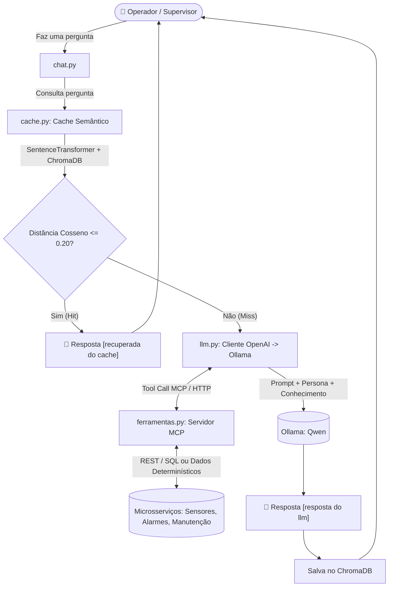

# 🏭 PlantaBot — Sistema Especialista para Supervisão e Manutenção de Planta Industrial

🎓 **Atividade Acadêmica**  
Projeto desenvolvido para a disciplina **Sistemas Especialistas para Web**  
**Curso:** Pós-Graduação em Desenvolvimento para Web  
**Instituição:** Instituto Federal de Educação, Ciência e Tecnologia da Bahia ([IFBA](https://portal.ifba.edu.br/))  
**Professor:** Luis Paulo da Silva Carvalho  

---

## 📌 Visão Geral

O **PlantaBot** é um agente inteligente e sistema especialista conversacional voltado ao diagnóstico operacional, supervisão de sensores, análise de alarmes de limite excedido (*setpoints*) e gestão de manutenção (preventiva, preditiva e corretiva) de uma planta industrial de pequeno porte (**PlantaView**).

O sistema integra Modelos de Linguagem de Larga Escala (LLMs) executados localmente através do **Ollama**, combinando:
- **Engenharia de Prompt, Persona Especialista e Base de Conhecimento Estruturada (`conhecimento/planta.json`)**;
- **Restrição de Escopo (*Guardrails*)**;
- **Ferramentas MCP (*Model Context Protocol*)** para consulta de telemetria, alarmes e ordens de serviço em tempo real (`ferramentas.py` e microsserviços em `servicos/` e `mcp/`);
- **Cache Semântico Vetorial (`cache.py`)** com embeddings (`SentenceTransformer`) e `ChromaDB`;
- **Avaliação Automatizada com LLM-as-a-Judge (`julgamento.py`)** e testes unitários (`teste.py`).

---

## 🚀 Principais Funcionalidades

- **Persona Especialista (`PlantaBot`):** Atua estritamente como especialista em instrumentação, supervisão e manutenção industrial dos 8 equipamentos da planta (*Bombas 1 e 2, Compressores 1 a 3, Motores 1 e 2, e Caldeira 1*).
- **Restrição de Domínio (*Guardrails*):** Caso receba perguntas fora do escopo industrial, o assistente recusa educadamente o atendimento (`"não posso responder esta pergunta"`).
- **Cache Semântico com Embeddings (`cache.py`):** Antes de acionar o LLM/MCP, o sistema gera embeddings da pergunta com `paraphrase-multilingual-MiniLM-L12-v2` e consulta uma coleção vetorial no `ChromaDB` (distância de cosseno $\le 0.20$). Perguntas semanticamente equivalentes são respondidas instantaneamente com a indicação `[recuperada do cache]`.
- **Ferramentas MCP (`ferramentas.py`):** Exposição de ferramentas via *Model Context Protocol* (`streamable-http`) para consulta de leituras de sensores, alarmes por severidade e ordens de serviço, integrando-se aos microsserviços REST/PostgreSQL (`servicos/`) ou operando de forma autônoma com dados determinísticos da planta.
- **Validação com LLM-as-a-Judge (`julgamento.py`):** Um modelo julgador (`qwen3:4b`) avalia automaticamente se as respostas do assistente (`qwen2.5:1.5b`) atendem aos critérios técnicos (`ATENDE`) e rejeita alucinações deliberadas (`NÃO ATENDE`).
- **Testes Automatizados (`teste.py`):** Suíte `unittest` para validação de assertividade conceitual e filtros de escopo.

---

## 🏗️ Arquitetura do Sistema



---

## 📂 Estrutura de Arquivos

```text
supervisorio-especialista/
│
├── conhecimento/
│   ├── planta.json           # Base de conhecimento estruturada da planta industrial (20 itens)
│   └── planta_menor.json     # Subconjunto enxuto para avaliação rápida no LLM-as-a-Judge
│
├── cache/                    # Diretório de persistência do banco vetorial ChromaDB
│
├── mcp/                      # Servidores MCP containerizados (Sensores :8001, Alarmes :8002, Manutenção :8003)
├── servicos/                 # Microsserviços REST Flask + PostgreSQL + Dashboard Web (dashboard.html)
│
├── cache.py                  # Gerenciamento de cache semântico (SentenceTransformer + ChromaDB)
├── ferramentas.py            # Servidor MCP unificado de ferramentas da planta (porta 8000)
├── llm.py                    # Comunicação com o servidor local do Ollama via API OpenAI
├── chat.py                   # Interface interativa de terminal e ciclo principal do especialista PlantaBot
├── julgamento.py             # Pipeline de avaliação com LLM-as-a-Judge e detecção de alucinações
├── teste.py                  # Testes de unidade automatizados (unittest)
├── requirements.txt          # Dependências Python do projeto
├── SDD-PlantaIndustrial.md   # Documento de especificação de projeto (Software Design Description)
└── README.md                 # Documentação do projeto
```

---

## 🛠️ Tecnologias Utilizadas

- **Linguagem:** Python 3.10+
- **Servidor de LLM Local:** [Ollama](https://ollama.com/)
  - **Modelo Assistente:** `qwen2.5:1.5b`
  - **Modelo Julgador:** `qwen3:4b`
- **Embeddings & Vetorização:** `sentence-transformers` (`paraphrase-multilingual-MiniLM-L12-v2`)
- **Banco Vetorial:** `chromadb` (persistência local com distância de cosseno)
- **Servidor e Cliente MCP:** `fastmcp` / `mcp` (`streamable-http`)
- **Cliente LLM:** `openai` (consumindo endpoint compatível do Ollama em `http://localhost:11434/v1/`)
- **Framework de Testes:** `unittest`

---

## ⚙️ Como Configurar e Executar

### 1. Clonar o repositório
```bash
git clone https://github.com/sidgubert/supervisorio-especialista.git
cd supervisorio-especialista
```

### 2. Criar e ativar o ambiente virtual
```bash
python -m venv venv
# Windows
.\venv\Scripts\activate
# Linux / macOS
source venv/bin/activate
```

### 3. Instalar as dependências
```bash
pip install -r requirements.txt
```

### 4. Iniciar o Ollama e baixar os modelos
Certifique-se de que o Ollama está rodando em `http://localhost:11434` e que os modelos estão disponíveis:
```bash
ollama pull qwen2.5:1.5b
ollama pull qwen3:4b
```

### 5. (Opcional) Iniciar o Servidor de Ferramentas MCP
Em um terminal separado, inicie o servidor MCP local na porta `8000`:
```bash
python ferramentas.py
```
*(Caso deseje subir também os microsserviços Docker completos com PostgreSQL e o Dashboard Web, consulte as instruções em `SDD-PlantaIndustrial.md`).*

---

## ▶️ Execução dos Módulos

### 💬 1. Conversar com o Especialista (PlantaBot)
```bash
python chat.py
```
O sistema indicará se a resposta foi obtida via cache vetorial `[recuperada do cache]` ou processada pelo modelo `[resposta do llm]`.

### ⚖️ 2. Executar o Julgamento Automatizado (LLM-as-a-Judge)
Executa a rotina que valida a rejeição de alucinações (`NÃO ATENDE`) e a conformidade técnica das respostas do assistente (`ATENDE`):
```bash
python julgamento.py
```

### 🧪 3. Executar os Testes Automatizados
Executa os testes unitários de assertividade conceitual e bloqueio de perguntas fora do domínio (*guardrails*):
```bash
python teste.py
```
