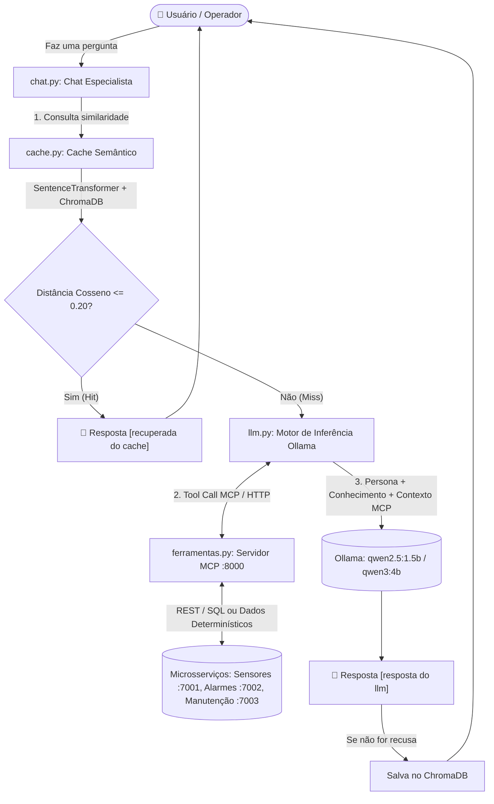

# SDD — Software Design Description
## PlantaBot — Sistema Especialista para Supervisão e Diagnóstico de Planta Industrial

| Campo               | Valor                                                                 |
|---------------------|-----------------------------------------------------------------------|
| **Projeto**         | PlantaBot / PlantaView — Sistema Especialista de Planta Industrial    |
| **Disciplina**      | Sistemas Especialistas para Web                                       |
| **Professor**       | Luis Paulo da Silva Carvalho                                          |
| **Instituição**     | IFBA — Pós-Graduação em Desenvolvimento Web                           |
| **Data de Entrega** | 20/11/2026                                                            |
| **Versão**          | 2.0                                                                   |
| **Norma Base**      | IEEE 1016 (Software Design Description) — adaptada                    |

---

## Sumário

1. [Introdução](#1-introdução)
2. [Referências](#2-referências)
3. [Glossário](#3-glossário)
4. [Visão Geral da Arquitetura](#4-visão-geral-da-arquitetura)
5. [Modelo de Domínio (Mini-Mundo)](#5-modelo-de-domínio-mini-mundo)
6. [Base de Conhecimento e Raciocínio Especialista](#6-base-de-conhecimento-e-raciocínio-especialista)
7. [Motor de Inferência (LLM via Ollama)](#7-motor-de-inferência-llm-via-ollama)
8. [Cache Semântico Vetorial (ChromaDB)](#8-cache-semântico-vetorial-chromadb)
9. [Viewpoint MCP (Model Context Protocol)](#9-viewpoint-mcp-model-context-protocol)
10. [Avaliação Automatizada (LLM-as-a-Judge)](#10-avaliação-automatizada-llm-as-a-judge)
11. [Microsserviços REST, Bancos de Dados e Dashboard](#11-microsserviços-rest-bancos-de-dados-e-dashboard)
12. [Estrutura de Diretórios do Projeto](#12-estrutura-de-diretórios-do-projeto)
13. [Plano de Verificação e Execução](#13-plano-de-verificação-e-execução)
14. [Rastreabilidade de Requisitos (IFBA-Especialistas-Avaliacao-v4)](#14-rastreabilidade-de-requisitos-ifba-especialistas-avaliacao-v4)

---

## 1. Introdução

### 1.1 Propósito

Este documento descreve o design de software do **PlantaBot**, um **Sistema Especialista conversacional** dedicado ao diagnóstico operacional, supervisão de grandezas físicas (temperatura, pressão e vibração), tratamento de alarmes de limite excedido (*setpoints*) e recomendação de manutenção (preventiva, preditiva e corretiva) em uma planta industrial de pequeno porte (**PlantaView**).

Em conformidade com a definição adotada na disciplina **Sistemas Especialistas para Web** (*"programas de computador que tentam resolver problemas que seres humanos resolveriam emulando o raciocínio de um especialista"*), o **PlantaBot** emula o raciocínio de um engenheiro de instrumentação e manutenção industrial: ele combina regras de domínio e limites normativos da base de conhecimento com dados operacionais consultados via ferramentas **MCP (Model Context Protocol)** para diagnosticar anomalias e prescrever ações corretivas.

### 1.2 Escopo e Módulos Essenciais

Atendendo integralmente aos requisitos do documento `IFBA-Especialistas-Avaliacao-v4.pdf`, a solução disponibiliza:

| Módulo Básico Esperado | Arquivo Principal | Responsabilidade Técnica |
|------------------------|-------------------|--------------------------|
| **Chat Especialista** | `chat.py` | Interface conversacional com o especialista (`PlantaBot`), orquestrando cache semântico, *guardrails* de escopo, chamadas MCP e inferência LLM. |
| **Motor de Inferência (LLM)** | `llm.py` | Integração com grandes modelos de linguagem executados localmente via **Ollama** (`qwen2.5:1.5b` e `qwen3:4b`) através de API compatível com OpenAI. |
| **Cache Semântico** | `cache.py` | Vetorização de perguntas com `SentenceTransformer` (`paraphrase-multilingual-MiniLM-L12-v2`) e armazenamento/busca por similaridade de cosseno ($\le 0.20$) no `ChromaDB`. |
| **Ferramentas MCP** | `ferramentas.py` e `mcp/` | Servidores *Model Context Protocol* (`streamable-http`) que expõem ferramentas de inspeção de sensores, alarmes, ordens de serviço e diagnóstico integrado de equipamentos. |
| **Julgamento (LLM-as-a-Judge)** | `julgamento.py` | Script automatizado que utiliza um modelo julgador (`qwen3:4b`) para validar respostas do assistente (`ATENDE`) e rejeitar alucinações (`NÃO ATENDE`). |
| **Testes Automatizados** | `teste.py` | Suíte `unittest` para verificação de precisão conceitual e bloqueio de perguntas fora do domínio (*guardrails*). |

---

## 2. Referências

| Documento / Recurso                    | Descrição                                                                 |
|----------------------------------------|---------------------------------------------------------------------------|
| `IFBA-Especialistas-Avaliacao-v4.pdf`  | Especificação oficial da avaliação da disciplina Sistemas Especialistas   |
| IEEE 1016-2009                         | Standard for Software Design Descriptions                                 |
| Repositório `progbot` / `progbot.ferramentas` | Arquitetura de referência exemplificada pelo Prof. Luis Paulo em aula |
| Model Context Protocol (MCP) Spec      | Protocolo aberto de comunicação entre LLMs e ferramentas externas         |
| Ollama + Qwen2.5 / Qwen3               | Servidor local de LLMs e modelos de inferência e julgamento               |
| SentenceTransformers & ChromaDB        | Biblioteca de embeddings multilíngues e banco de dados vetorial           |

---

## 3. Glossário

| Termo               | Definição                                                                                      |
|---------------------|------------------------------------------------------------------------------------------------|
| **Sistema Especialista** | Programa que resolve problemas complexos de um domínio emulando o raciocínio de um perito humano |
| **MCP**             | Model Context Protocol — protocolo aberto para expor ferramentas e contexto para modelos de IA |
| **Cache Semântico** | Mecanismo que recupera respostas anteriores com base na proximidade vetorial (significado) da pergunta |
| **LLM-as-a-Judge**  | Técnica de avaliação em que um LLM perito julga se a resposta de outro modelo atende aos requisitos |
| **Setpoint**        | Valor-limite operacional configurado que, ao ser ultrapassado, caracteriza anomalia e gera alarme |
| **OS**              | Ordem de Serviço — registro formal de intervenção de manutenção (preventiva, preditiva ou corretiva) |

---

## 4. Visão Geral da Arquitetura

### 4.1 Fluxo Arquitetural Integrado



### 4.2 Mapa de Portas

| Componente                     | Porta Host | Protocolo               | Papel na Arquitetura                              |
|--------------------------------|------------|-------------------------|---------------------------------------------------|
| **Ollama Server**              | `11434`    | HTTP (OpenAI API `/v1`) | Motor de inferência LLM (`qwen2.5:1.5b`, `qwen3:4b`) |
| **Servidor MCP Unificado**     | `8000`     | HTTP (`streamable-http`)| Servidor MCP principal (`ferramentas.py`)         |
| **MCP Sensores (Docker)**      | `8001`     | HTTP (`streamable-http`)| Servidor MCP dedicado ao serviço de sensores      |
| **MCP Alarmes (Docker)**       | `8002`     | HTTP (`streamable-http`)| Servidor MCP dedicado ao serviço de alarmes       |
| **MCP Manutenção (Docker)**    | `8003`     | HTTP (`streamable-http`)| Servidor MCP dedicado ao serviço de manutenção    |
| **Serviço REST Sensores**      | `7001`     | HTTP/REST               | Microsserviço Flask + PostgreSQL (`:7004`)        |
| **Serviço REST Alarmes**       | `7002`     | HTTP/REST               | Microsserviço Flask + PostgreSQL (`:7005`)        |
| **Serviço REST Manutenção**    | `7003`     | HTTP/REST               | Microsserviço Flask + PostgreSQL (`:7006`)        |

---

## 5. Modelo de Domínio (Mini-Mundo)

Uma **planta industrial de pequeno porte** opera com **8 equipamentos instrumentados**, monitorados continuamente por sensores de **Temperatura (°C)**, **Pressão (bar)** e **Vibração (mm/s)**:

| ID  | Equipamento     | Tipo        | Localização       | Setpoint Temp. (°C) | Setpoint Pressão (bar) | Setpoint Vibração (mm/s) |
|-----|-----------------|-------------|-------------------|---------------------|------------------------|--------------------------|
| 1   | Bomba 1         | `bomba`     | Sala de Bombas    | 20,0 a 60,0         | 1,0 a 5,0              | 0,0 a 10,0               |
| 2   | Bomba 2         | `bomba`     | Sala de Bombas    | 20,0 a 60,0         | 1,0 a 5,0              | 0,0 a 10,0               |
| 3   | Compressor 1    | `compressor`| Utilidades        | 30,0 a 80,0         | 5,0 a 12,0             | 0,0 a 15,0               |
| 4   | Compressor 2    | `compressor`| Utilidades        | 30,0 a 80,0         | 5,0 a 12,0             | 0,0 a 15,0               |
| 5   | Compressor 3    | `compressor`| Utilidades        | 30,0 a 80,0         | 5,0 a 12,0             | 0,0 a 15,0               |
| 6   | Motor 1         | `motor`     | Linha de Produção | 40,0 a 90,0         | N/A                    | 0,0 a 20,0               |
| 7   | Motor 2         | `motor`     | Linha de Produção | 40,0 a 90,0         | N/A                    | 0,0 a 20,0               |
| 8   | Caldeira 1      | `caldeira`  | Casa de Caldeiras | 100,0 a 200,0       | 10,0 a 25,0            | 0,0 a 5,0                |

Quando uma leitura ultrapassa o *setpoint* configurado, um **alarme** é registrado (`baixa`, `media`, `alta` ou `critica`) com ciclo de vida (`ativo`, `reconhecido`, `encerrado`). Anomalias geram **Ordens de Serviço (OS)** classificadas em manutenção `preventiva`, `preditiva` ou `corretiva`.

---

## 6. Base de Conhecimento e Raciocínio Especialista

A base de conhecimento estruturada reside em `conhecimento/planta.json` (e o subconjunto de validação rápida em `conhecimento/planta_menor.json`), contendo pares de regras e diagnósticos técnicos que parametrizam a persona do **PlantaBot**:

1. **Identidade e Saudação:** Identifica-se como o software especialista **PlantaBot**, explicando sua atuação no diagnóstico de sensores, alarmes e manutenção da planta industrial.
2. **Restrição de Domínio (*Guardrails*):** Qualquer pergunta fora do escopo de supervisão e manutenção industrial recebe a recusa padronizada: `"não posso responder esta pergunta"`.
3. **Conhecimento Normativo e Diagnóstico:**
   - Faixas operacionais (*setpoints*) por classe de equipamento;
   - Diagnóstico de **cavitação** em bombas hidráulicas (oscilação de pressão + elevação de vibração e temperatura);
   - Diagnóstico de **sobrepressão crítica** na Caldeira 1 (> 25 bar, associada a vazamento/falha na válvula de segurança);
   - Diagnóstico de **superaquecimento crítico** no Compressor 3 (> 80 °C, associado a falha no sistema de refrigeração);
   - Diagnóstico de **vibração mecânica excessiva** em motores e rotores (desalinhamento, desbalanceamento ou desgaste de rolamentos).

---

## 7. Motor de Inferência (LLM via Ollama)

O módulo `llm.py` encapsula a comunicação com o servidor local **Ollama** (`http://localhost:11434/v1/`) utilizando a biblioteca `openai`:

- **Modelo Assistente (`chat.py` / `julgamento.py`):** `qwen2.5:1.5b` (temperatura `0.1` para respostas determinísticas e técnicas).
- **Modelo Julgador (`julgamento.py`):** `qwen3:4b` (com filtro `limpar_pensamento()` para remoção de tags `<think>...</think>`).
- **Suporte a Tool Calling (`obter_resposta_com_ferramentas`):** Repassa a lista de ferramentas MCP convertidas para o schema de funções da API OpenAI/Ollama, permitindo que o modelo decida autonomamente quando invocar uma ferramenta antes de formular o parecer final.

---

## 8. Cache Semântico Vetorial (ChromaDB)

O módulo `cache.py` evita reprocessamento no LLM para perguntas semanticamente equivalentes:

1. **Normalização e Identificação:** A pergunta é normalizada (`normalizar_pergunta`) e convertida em um ID único SHA-256 (`gerar_id_cache`).
2. **Geração de Embeddings:** Utiliza o modelo multilíngue `sentence-transformers/paraphrase-multilingual-MiniLM-L12-v2` com embeddings normalizados (`normalize_embeddings=True`).
3. **Busca por Similaridade (`buscar_cache`):** Consulta a coleção `plantabot_cache` no `chromadb.PersistentClient` configurada com espaço métrico de cosseno (`{"hnsw:space": "cosine"}`).
4. **Critério de Hit (`LIMIAR_DISTANCIA_CACHE = 0.20`):**
   - Se `distancia <= 0.20`, retorna a resposta armazenada com a tag `[recuperada do cache]`.
   - Se `distancia > 0.20` (*Cache Miss*), aciona o motor de inferência LLM/MCP, exibe `[resposta do llm]` e persiste o par `(pergunta, resposta)` via `gravar_cache` (exceto quando a resposta é uma recusa de *guardrail*).

---

## 9. Viewpoint MCP (Model Context Protocol)

O módulo `ferramentas.py` implementa um servidor MCP (`MCPServer("supervisao_planta_industrial")`) exposto via transporte `streamable-http` em `http://0.0.0.0:8000/mcp` (além dos servidores containerizados em `mcp/sensores`, `mcp/alarmes` e `mcp/manutencao` nas portas `8001` a `8003`).

### Ferramentas Expostas pelo Servidor MCP

| Ferramenta                  | Descrição                                                                                  | Parâmetros                     |
|-----------------------------|--------------------------------------------------------------------------------------------|--------------------------------|
| `leituras_por_equipamento`  | Retorna as leituras recentes de sensores de um equipamento específico                      | `equipamento_id`               |
| `leituras_por_grandeza`     | Retorna leituras de um equipamento filtradas por grandeza (`temperatura`, `pressao`, `vibracao`) | `equipamento_id`, `grandeza` |
| `ultima_leitura`            | Retorna a última leitura de cada sensor de todos os equipamentos da planta                 | —                              |
| `alarmes_por_equipamento`   | Retorna o histórico e alarmes ativos de um equipamento                                     | `equipamento_id`               |
| `alarmes_por_severidade`    | Retorna alarmes filtrados por severidade (`baixa`, `media`, `alta`, `critica`)             | `severidade`                   |
| `resumo_alarmes`            | Retorna a contagem agregada de alarmes por equipamento e severidade                        | —                              |
| `ordens_por_equipamento`    | Retorna as ordens de serviço de manutenção de um equipamento                               | `equipamento_id`               |
| `ordens_por_status`         | Retorna ordens de serviço filtradas por status (`aberta`, `em_andamento`, `concluida`, `cancelada`) | `status`              |
| `resumo_manutencao`         | Retorna o resumo de ordens abertas, em andamento e concluídas por equipamento              | —                              |
| `diagnosticar_equipamento`  | Consolida leituras atuais, desvios de *setpoint*, alarmes ativos e OS abertas para diagnóstico | `equipamento_id`           |

> **Modo Resiliente Dual:** Cada ferramenta tenta consultar prioritariamente os microsserviços REST (`localhost:7001-7003`) e, caso os contêineres Docker não estejam ativos, utiliza os dados determinísticos da planta embutidos no servidor MCP, garantindo funcionamento contínuo em qualquer ambiente de avaliação.

---

## 10. Avaliação Automatizada (LLM-as-a-Judge)

O script `julgamento.py` implementa a avaliação automatizada do Sistema Especialista utilizando a técnica **LLM-as-a-Judge**:

1. **Persona do Julgador (`iniciar_persona_julgamento`):** Parametriza o modelo `qwen3:4b` como perito avaliador munido do gabarito de referência, instruído a responder exclusivamente `'ATENDE'` ou `'NÃO ATENDE'`.
2. **Detecção de Alucinações (`avaliar_alucinacoes`):** Submete respostas deliberadamente falsas/alucinadas para perguntas do domínio industrial e valida via `assert("NÃO ATENDE" in julgamento)` que o juiz rejeita alucinações.
3. **Avaliação do Assistente (`julgar_assistente`):** Submete as perguntas de avaliação ao assistente **PlantaBot** (`qwen2.5:1.5b`), coleta as respostas geradas e as envia ao julgador (`qwen3:4b`), validando via `assert("NÃO ATENDE" not in julgamento)` a precisão técnica do sistema especialista.

---

## 11. Microsserviços REST, Bancos de Dados e Dashboard

A camada de persistência e visualização web (`servicos/`) é composta por:
- **Três microsserviços Flask RESTful** (`sensores:7001`, `alarmes:7002`, `manutencao:7003`), cada um com seu próprio banco **PostgreSQL** (`dados-sensores:7004`, `dados-alarmes:7005`, `dados-manutencao:7006`) inicializado com seeds determinísticos (`init.sql`).
- **Dashboard Web Resiliente (`servicos/dashboard.html`):** Painel HTML/JS/Chart.js que consome os três microsserviços de forma independente, mantendo as demais seções operacionais caso algum serviço fique indisponível.

---

## 12. Estrutura de Diretórios do Projeto

```text
supervisorio-especialista/
├── conhecimento/
│   ├── planta.json           # Base de conhecimento estruturada do especialista (20 itens)
│   └── planta_menor.json     # Base enxuta para execução rápida do LLM-as-a-Judge
├── cache/                    # Persistência local do banco vetorial ChromaDB
├── mcp/                      # Servidores MCP containerizados (Docker)
├── servicos/                 # Microsserviços REST Flask + PostgreSQL + Dashboard Web
├── cache.py                  # Módulo de Cache Semântico (SentenceTransformer + ChromaDB)
├── ferramentas.py            # Servidor MCP de ferramentas da planta industrial
├── llm.py                    # Motor de inferência LLM integrado ao Ollama
├── chat.py                   # Chat interativo do Sistema Especialista PlantaBot
├── julgamento.py             # Script de avaliação automatizada (LLM-as-a-Judge)
├── teste.py                  # Testes unitários automatizados (unittest)
├── requirements.txt          # Dependências Python do projeto
├── SDD-PlantaIndustrial.md   # Software Design Description (este documento)
└── README.md                 # Guia rápido de instalação, arquitetura e execução
```

---

## 13. Plano de Verificação e Execução

```bash
# 1. Instalar dependências Python
pip install -r requirements.txt

# 2. Garantir modelos no Ollama (rodando em http://localhost:11434)
ollama pull qwen2.5:1.5b
ollama pull qwen3:4b

# 3. (Opcional) Iniciar o servidor MCP em um terminal separado
python ferramentas.py

# 4. Executar o Julgamento Automatizado (LLM-as-a-Judge)
python julgamento.py

# 5. Executar os Testes Unitários
python teste.py

# 6. Iniciar o Chat Interativo com o Especialista PlantaBot
python chat.py
```

---

## 14. Rastreabilidade de Requisitos (`IFBA-Especialistas-Avaliacao-v4.pdf`)

| Item / Requisito da Avaliação | Descrição da Exigência | Como o Projeto Atende |
|-------------------------------|------------------------|-----------------------|
| **Seção 2 (Escopo)** | Concretização de um Sistema Especialista em formato de chatbot com mini-mundo próprio que emule o raciocínio de um especialista. | Mini-mundo de planta industrial (**PlantaView**) onde o **PlantaBot** diagnostica desvios de sensores, alarmes e ordens de serviço. |
| **Item 2 e 3 (Originalidade)** | Não reutilizar o tema de POO (*ProgBot*) e possuir tema inédito. | Domínio de Supervisão, Diagnóstico Operacional e Manutenção de Planta Industrial. |
| **Item 5(a) (Chat)** | Disponibilizar um chat para interação com o especialista. | Implementado em `chat.py` com persona especialista, *guardrails* de escopo e integração MCP/Cache. |
| **Item 5(b) e 8 (LLM)** | Motor de inferência baseado em grande modelo de IA. | Implementado em `llm.py` consumindo modelos locais via **Ollama** (`qwen2.5:1.5b` e `qwen3:4b`). |
| **Item 5(c) e 8 (Cache Semântico)** | Cache semântico para registro e retorno de respostas para perguntas anteriormente processadas. | Implementado em `cache.py` com `SentenceTransformer` (`paraphrase-multilingual-MiniLM-L12-v2`) e `ChromaDB` (cosseno $\le 0.20$). |
| **Item 5(d) e 8 (LLM-as-a-Judge)** | Script adicional para avaliação do sistema especialista utilizando *LLM-as-a-Judge*. | Implementado em `julgamento.py` avaliando alucinações (`NÃO ATENDE`) e respostas do especialista (`ATENDE`). |
| **Item 8 (Ferramentas MCP)** | Presença clara de ferramentas MCP no código e na demonstração. | Implementado em `ferramentas.py` (servidor FastMCP/MCPServer) e integrado ao fluxo de conversa em `chat.py`. |
